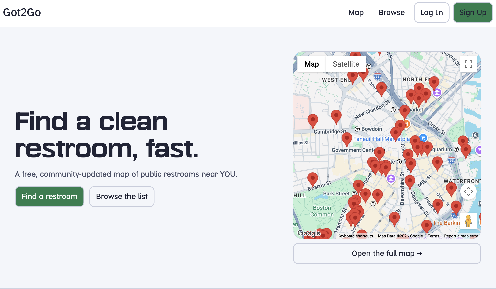

# 🚻 Got2Go

Find a clean public restroom nearby, fast.

> **Work in progress:** this is my Demo Day build. Features are still being added, and things may change or break.

## Preview

[Live Link: Got2Go](https://restroomdemoday-1.onrender.com/)

## 📖 About

Got2Go is a free, community-updated map of public restrooms. Users can browse restrooms on a map or in a list, check details like hours, whether it's free, and whether there's a baby changing table, and get directions in one tap. Restroom locations come from the [Refuge Restrooms](https://www.refugerestrooms.org/) public API.

---

## ✅ Current Features

- Landing page with a live mini map, built for phones and desktop
- Interactive Google map with a pin for every restroom
- Pin popups that link to each restroom's details page
- Real restroom data imported from the Refuge Restrooms API (Boston area)
- Browse list of all restrooms
- "Get directions" button that opens Google Maps
- Edit restroom details: hours, free, open 24 hours, baby changing table
- User accounts: sign up, log in, log out

## 🚧 Coming Soon

- Reviews with a star rating, quick tags, and comments
- Average ratings on each restroom
- Delete your own reviews
- Save favorite restrooms
- Photos of restrooms
- Search by city or zip code

---

## 🛠️ Built With

Node.js · Express · MongoDB · Mongoose · EJS · Passport · Google Maps JavaScript API · Refuge Restrooms API

---

## 💡 What I'm Learning

- Planning a project from the very first idea
- Structuring an Express app with MVC so it's easy to grow
- Working with outside APIs and location data
- Authentication with Passport and hashed passwords
- Shipping an early version and improving it over time